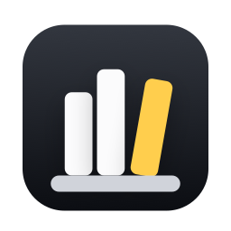
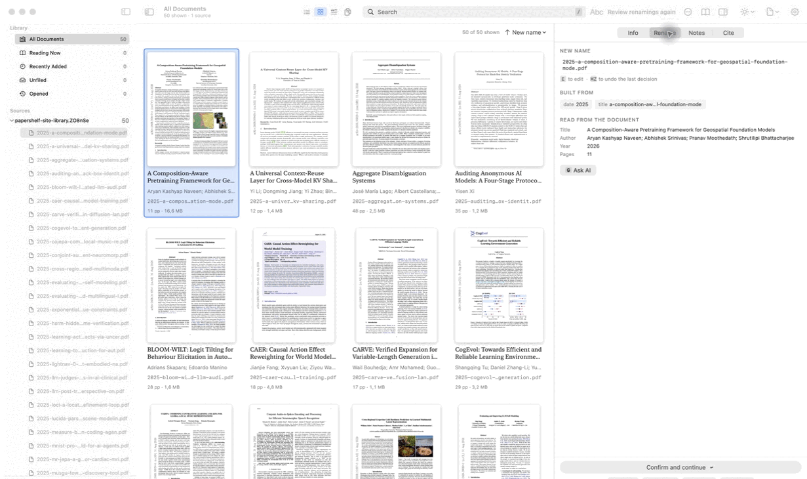

# PaperShelf

A PDF reader and research library for the Mac. It reads, searches, highlights, renames and
cites the papers already in your folders, reads scans with the OCR built into macOS, and
lets Claude, Codex or ChatGPT search the whole shelf and answer with the passage and the
page, without a file leaving the machine.



## What it does

**Reads from the keyboard.** Close to ninety commands, all in the ⌘K palette, and any of
them can take a key of your choosing. H, J, K and L scroll the page; Shift-J and
Shift-K move to the next file. Tabs, a split view, zen mode, four page colours, and
presentation mode on ⌃⌘F. Bookmarks, a table of contents, and find within the document.

**Highlights that mean something.** Five highlighters with meanings you can rename,
recolour and extend, scoped to one paper, a project, a folder or the whole library. Notes
sit beside the passage they are about, can be dictated, and are written to a Markdown file
beside the PDF. Marks made in Preview, Acrobat or any other app join the notes too, because
the PDF's own annotations are the source of truth.

**Finds what you half remember.** Full-text search across every paper, with a query
language for title, author, abstract, text, folder, tag, year, pages and size. Scans can be
read too: Convert to Markdown uses a paper's text layer, the OCR built into macOS for a page
that has none, or pdftotext, MarkItDown, Marker or Docling when you have them, and keeps the
result as the paper's searchable text. Projects read their papers the same way.

**Answers questions about your library.** A bundled MCP server gives a local assistant
26 tools over the shelf: search, read a document or a page, list, add, edit and remove
highlights and their notes, list bookmarks, build a bibliography, work with projects and
tags. Settings > Integrations shows the exact line to paste into Claude Code or Codex.
Highlights an assistant adds are written into the PDF the way your own are, signed with its
name. Tools that
would rename or move your files are off until you turn them on, and every such change is
proposed before it is applied.

**Keeps the shelf in order.** Names built from date, author, title and year, previewed
before anything moves, with originals kept when you ask. Watched folders stay current, and a
new copy of a paper you already have is caught and reviewed before anything is removed.
Reading projects group papers across folders, and tags cut across both.

**Cites.** BibTeX for any selection, with stable `surname:year:firstword` keys and missing
fields called out where you can fix them.

**Saves the web as a paper.** Open a website in the reader (⌘L), save a paginated PDF with
its web archive and citation, and highlight it like any other document.

Everything stays on the Mac: the index is SQLite, API keys are in the Keychain, and AI
features, MCP access included, can be turned off with one switch in Settings > General.

## Install

```sh
brew tap jonaprieto/papershelf
brew trust --cask jonaprieto/papershelf/papershelf
brew install --cask papershelf
```

Or download the DMG from the [latest release](https://github.com/jonaprieto/papershelf/releases/latest).
It runs on macOS 14 or later. Builds are ad-hoc signed while notarization is on the
roadmap, so the first launch may need right-click, Open in Finder.

To update, run `brew update && brew upgrade --cask papershelf`. The app also notices a newer
release and shows it beside its version; **Check for updates** is in the app menu, About and
the palette, and automatic checks can be turned off in General settings.

PaperShelf is under active development. It is in daily use, but a release can still change
stored preferences and behaviour.

### Build from source

```sh
./build.sh            # build dist/PaperShelf.app
./build.sh --install  # build and install in /Applications
```

There are no third-party Swift package dependencies. [HACKING.md](HACKING.md) has the build
and test contract.

## Connecting an assistant

Open Settings > Integrations. It shows the path of the bundled server and the line to add
it, for Claude Code:

```sh
claude mcp add papershelf -- "/Applications/PaperShelf.app/Contents/MacOS/papershelf-mcp"
```

and for Codex, a `[mcp_servers.papershelf]` entry with the same command. ChatGPT and other
local MCP clients take the same path. Search reads the text index, so run **Index text for
search** on a shelf before asking about it.

## Web articles

Use File > Open Website (⌘L), the globe toolbar button, or the palette. Navigate to an
article, then choose **Save copy**. This saves the loaded page as a paginated A4 PDF, the
web archive, and a BibTeX companion under PaperShelf's Application Support folder. The
reading copy joins the catalogue with the same notes, highlights, search, page colours and
split view as any other document. Selecting text on the live page and choosing a highlight
colour marks that passage in the reading copy; an ambiguous match asks you to select in the
saved copy instead.

**Open live** opens the article's website in the same pane, beside a PDF if you like.
**Save new version** keeps a new copy and leaves the existing copies and their annotations
alone. A snapshot holds what was loaded at capture time: it does not crawl linked pages or
fetch what sits behind a login or an unopened section. Capture waits for MathJax and web
fonts, so equations keep their look, though equations drawn as images or SVG may not have
selectable text.

Citation facts come from the Highwire, Dublin Core, Open Graph and schema.org metadata the
page supplies. Missing authors and dates stay missing rather than guessed. The citation
carries the source URL and capture date; review it in the Cite inspector before
publication.

## Asking a model

**Ask AI** on a selection, a mark, or the notes export bar uses the endpoint and model set
in Settings, and shows the text and the destination before anything is sent. To use a local
model, start its server and choose **LM Studio** or **llama.cpp** in Settings > AI & spend;
localhost can use an empty key, and local credentials are stored apart from cloud ones.

Turning off **AI features** in Settings > General hides the model tools, cancels pending
requests, and blocks ChatGPT handoffs and MCP access. Reading, annotation, local search and
citation lookup keep working. A request already sent cannot be recalled.

## Roadmap

- [ ] Notarized and signed releases
- [ ] Stable 2.0 storage and plugin interfaces
- [ ] Upstream Homebrew Cask submission when the project meets its requirements

## Links

- [Landing page](https://jonaprieto.github.io/papershelf/)
- [Latest release](https://github.com/jonaprieto/papershelf/releases/latest)
- [Build and test contract](HACKING.md)
- [Contributing](CONTRIBUTORS.md)
- [Changelog](CHANGELOG.md)
